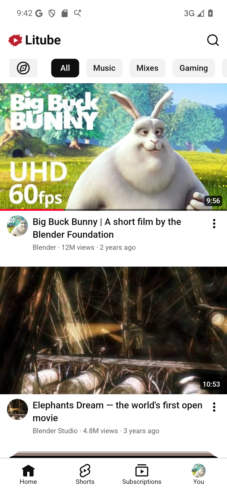
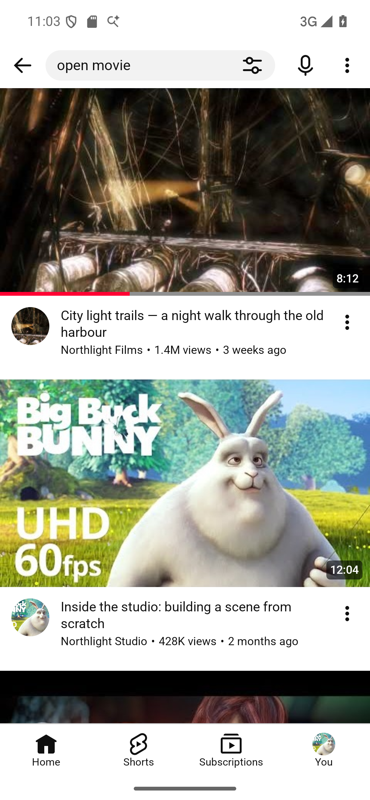
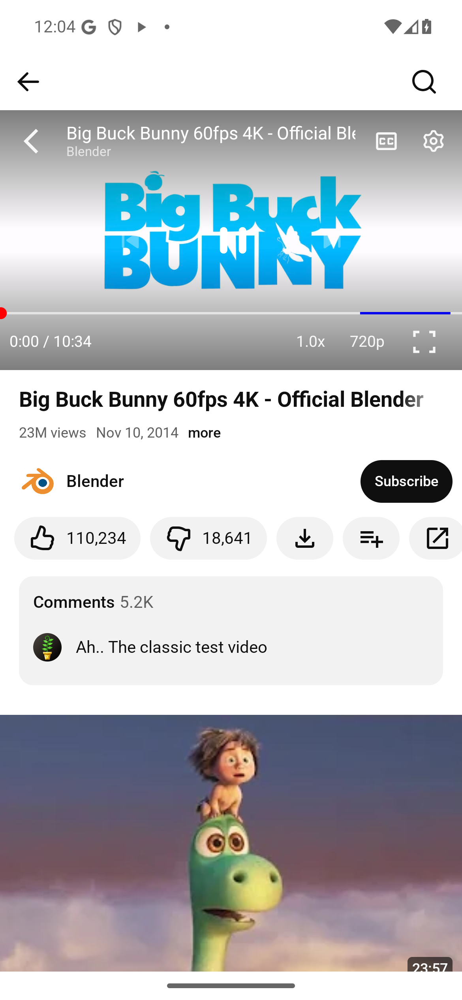

<div align="center">
  <h1><br>Litube</h1>
<p>An unofficial, open-source YouTube client for Android.</p>

  <p>
    <!-- Restore the F-Droid badge when its package is updated to v4.
    <a href="https://f-droid.org/packages/com.hhst.litube/"></a>
    -->
    <a href="https://github.com/HydeYYHH/litube/releases"></a>
  </p>

  <p>
    
    
    <a href="LICENSE"></a>
  </p>
</div>

Built on a [fork of MediaServiceCore](https://github.com/HydeYYHH/MediaServiceCore), the YouTube engine used by [SmartTube](https://github.com/yuliskov/SmartTube), and inspired by [NewTube](https://github.com/aleixrodriala/newtube). Our thanks to the maintainers and contributors of both projects for the work, code, and ideas that make Litube possible.

Browse videos and Shorts, follow your favorite channels, and organize your playlists in an Android interface built with Jetpack Compose. Watch videos, listen in the background, or save your favorites for offline playback.

## Previews

<p align="center">
  <a href=".github/assets/screenshots/v4-home.png"></a>
  &nbsp;
  <a href=".github/assets/screenshots/v4-search.png"></a>
  &nbsp;
  <a href=".github/assets/screenshots/v4-playback.png"></a>
  &nbsp;
  <a href=".github/assets/screenshots/v4-subscriptions.png"></a>
</p>

## Features

- **Browse YouTube.** Explore your home feed, search for videos, and browse channels, playlists, Shorts, and your library.
- **Play your way.** Enjoy ad-free playback with controls for video quality, speed, subtitles, and audio tracks. Keep listening in the background, use picture-in-picture or the mini-player, or cast to another device.
- **Download for later.** Save videos, audio, subtitles, or entire playlists. Choose the quality and language, and pause or resume downloads as needed.
- **Keep things organized.** Build queues with shuffle, repeat, and autoplay. Watch history and Watch later are available even when you're signed out.
- **Multiple accounts, all in one.** Easily switch between your anonymous account and multiple signed-in accounts.
- **Make it yours.** Customize SponsorBlock, playback gestures, themes, and language. Enable DeArrow for alternative titles and thumbnails.

## Downloads

Get APKs and release notes from [GitHub Releases](https://github.com/HydeYYHH/litube/releases), or [build the app from source](#build-from-source).

**Requirements:** Android **7.0 / API 24** or later and an up-to-date **Android System WebView**. Picture-in-picture requires Android **8.0 / API 26** or later and a compatible device.

## Milestones

| Release | Milestone |
| --- | --- |
| [v1](https://github.com/HydeYYHH/litube/releases/tag/v1.4.9)<br>`2025-02` | **The start of our journey**<br>A lightweight WebView client with ad blocking, background playback and downloads. |
| [v2](https://github.com/HydeYYHH/litube/releases/tag/v2.0.0)<br>`2026-01` | **Playback and downloads**<br>Added native Media3 player, NewPipe-based stream extraction, picture-in-picture, and a download manager while keeping YouTube's web interface. |
| [v3](https://github.com/HydeYYHH/litube/releases/tag/v3.0.0)<br>`2026-10` | **A Kotlin rewrite**<br>Rebuilt the app with Kotlin and Jetpack Compose, reworking player and downloader while keeping WebView-based browsing. |
| [v4.0.0](https://github.com/HydeYYHH/litube/releases)<br>`2026-11` | **Native browsing**<br>Replaced WebView browsing with native Compose screens and [MediaServiceCore](https://github.com/HydeYYHH/MediaServiceCore), bringing anonymous and signed-in accounts together with the Media3 player and download system. |

## Build from source

Use **JDK 21**, **Android SDK Platform 36**, and **Build Tools 36.0.0** to match the CI environment. The repository includes a **Gradle 8.11.1** wrapper.

Clone the v4 branch:

```sh
git clone --branch v4 https://github.com/HydeYYHH/litube.git
cd litube
```

Gradle downloads MediaServiceCore v1.0.0 from JitPack using the version pinned in `gradle/libs.versions.toml`.

Set `ANDROID_HOME` to your Android SDK directory, or set `sdk.dir` in an untracked `local.properties` file. Then build the debug APK:

```sh
./gradlew :app:assembleDebug
```

On Windows, replace `./gradlew` with `.\gradlew.bat` in these commands.

The debug APK is saved to `app/build/outputs/apk/debug/app-debug.apk`. Debug builds use the application ID `com.hhst.litube.debug`; release builds use `com.hhst.litube`.

To build the release APK, run `./gradlew :app:assembleRelease`. The unsigned APK is saved to `app/build/outputs/apk/release/app-release-unsigned.apk`; sign it with your release key before distribution.

<details>
<summary><strong>Tests and verification</strong></summary>

Run unit tests and Android lint checks:

```sh
./gradlew :app:testDebugUnitTest :app:lintDebug
```

Build the instrumented test APK:

```sh
./gradlew :app:assembleDebugAndroidTest
```

Instrumented tests use local fixtures by default. To run live-service read checks, pass `network=1` as an instrumentation runner argument. See [CONTRIBUTING.md](CONTRIBUTING.md) and the [Android workflow](.github/workflows/android.yml) for device testing and release verification, including R8 checks.

</details>

<details>
<summary><strong>Tech stack</strong></summary>

Litube is built with **Kotlin**, Jetpack Compose / Material 3, **AndroidX Media3**, **coroutines / StateFlow**, **Koin**, **Room**, **WorkManager**, and **OkHttp**.

Content and stream extraction are provided by the [MediaServiceCore fork maintained for Litube](https://github.com/HydeYYHH/MediaServiceCore).

</details>

## Contributing

Bug reports, translations, and focused pull requests are welcome. Read [CONTRIBUTING.md](CONTRIBUTING.md) for the project structure, coding conventions, and validation steps.

When [reporting a bug](https://github.com/HydeYYHH/litube/issues), include your app version, device model, Android version, steps to reproduce the issue, and what you expected to happen. Describe what happened instead and attach a diagnostic archive if available.

## Acknowledgements

Built on a [fork of MediaServiceCore](https://github.com/HydeYYHH/MediaServiceCore), the YouTube engine used by [SmartTube](https://github.com/yuliskov/SmartTube), and inspired by [NewTube](https://github.com/aleixrodriala/newtube). Our thanks to the maintainers and contributors of both projects for the work, code, and ideas that make Litube possible.

Parts of the Cast implementation are adapted from [NewTube](https://github.com/aleixrodriala/newtube), with the original license and attribution retained. Litube also builds on AndroidX Media3 and the wider open-source Android ecosystem, with support for SponsorBlock and DeArrow.

## Star History

<p align="center">
  <a href="https://www.star-history.com/?repos=HydeYYHH%2Flitube&type=date">
    <picture>
      <source media="(prefers-color-scheme: dark)" srcset="https://api.star-history.com/svg?repos=HydeYYHH/litube&type=Date&theme=dark">
      <source media="(prefers-color-scheme: light)" srcset="https://api.star-history.com/svg?repos=HydeYYHH/litube&type=Date">
      
    </picture>
  </a>
</p>

---

<p align="center">
  <strong>Litube</strong> · Licensed under the <a href="LICENSE">GNU GPL v3.0</a>
</p>
